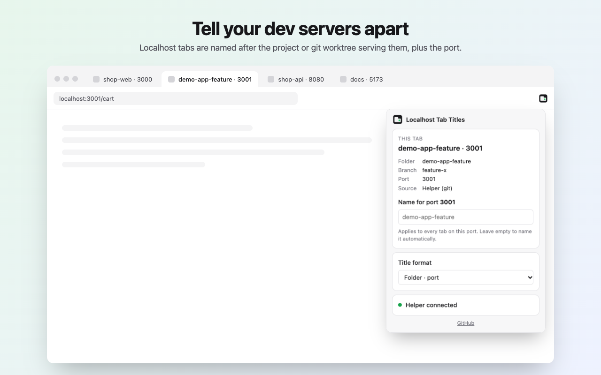

# Localhost Tab Titles

Running five dev servers and every tab says "Create Next App"? This extension names each
localhost tab after the project, or git worktree, that's serving it:



Built for [Dia](https://www.diabrowser.com/). It also works in Chrome, Arc, Brave, Edge,
Vivaldi, and other Chromium browsers.

## Features

- **Project names in tabs:** `my-app · 3000`, `my-app-checkout · 3001`. Each git worktree gets its own name.
- **Sticks:** Next.js, Vite, and other apps change the title as you navigate; the extension puts it back.
- **Title format:** folder · port, branch · port, port · folder, or folder (branch) · port.
- **Rename by port:** call port 8080 "api" from the popup. Works for Docker and anything else, and doesn't need the helper.
- **Hosts:** `localhost`, `127.0.0.1`, `0.0.0.0`, `*.localhost`, and `[::1]`, on any port.

## Install

### 1. The extension

From the Chrome Web Store: *coming soon*.

Or from source:

1. Download this repo (**Code → Download ZIP**, then unzip) or `git clone` it.
2. In Dia, open `chrome://extensions` and turn on **Developer mode** (top right).
3. Click **Load unpacked** and choose the `extension` folder.

Without the helper, tabs show `localhost:3000`. That's already useful, and renaming ports
from the popup works too.

### 2. The helper (macOS, optional): project and branch names

A browser extension can't see which folder a server was started from, so a small helper
looks it up. Paste this in Terminal:

```bash
curl -fsSL https://raw.githubusercontent.com/Jynx-hub/localhost-tab-titles/main/helper/install.sh | bash
```

Or from a clone: `./helper/install.sh`.

It needs `python3` and `git`, which come with the Xcode Command Line Tools
(`xcode-select --install`). It installs for every Chromium browser it finds (Dia, Chrome,
Arc, Brave, Edge, Chromium, Vivaldi). Reload your localhost tabs afterwards.

Nothing runs in the background. The browser starts the helper for a moment when a tab needs
a name, and it exits right after answering.

To remove it:

```bash
curl -fsSL https://raw.githubusercontent.com/Jynx-hub/localhost-tab-titles/main/helper/uninstall.sh | bash
```

## How it works

```
tab (title.js) ──▶ service worker ──native messaging──▶ helper (python3, started on demand)
                                                         lsof: who listens on :3001?  → pid 4242
                                                         lsof: its working directory? → ~/code/my-app-checkout
                                                         git:  repo / worktree + branch
```

1. A content script on localhost pages asks the extension's service worker for a label.
2. A name you set for that port wins. Otherwise the worker asks the helper.
3. The helper finds the process listening on the port, gets its working directory, and asks
   git for the repo or worktree folder name and branch. A folder that isn't a git repo is
   reported by its plain name.
4. The content script pins the title and puts it back whenever the page changes it.

If nothing resolves (a Docker container, an SSH tunnel, a server started from `/`), the tab
shows `localhost:<port>`. Name it from the popup.

### Security

- The helper uses Chrome's [native messaging](https://developer.chrome.com/docs/extensions/develop/concepts/native-messaging).
  It has no network port, and the browser only lets the extension IDs listed in its
  manifest start it.
- It only accepts a port number and only returns a folder name and branch. Input that
  isn't a number is ignored.
- The extension has no access to web pages other than localhost ones, and makes no
  network requests.

## Privacy

Nothing leaves your machine. See [PRIVACY.md](PRIVACY.md).

## Troubleshooting

| Popup says | Fix |
|---|---|
| Helper not installed | Run the install command, then reopen the popup. |
| Helper doesn't allow this extension | The helper was installed for another build (e.g. Web Store vs unpacked). Run the installer again. |
| Helper isn't responding | Run the installer again; it tests the helper at the end and prints any error. |
| Name is wrong after `git checkout` | Switch away from the tab and back; it re-checks when the tab becomes visible. |

## Development

```bash
npm install
npx playwright install chromium
npm test                       # host + installer + format unit tests, then the browser e2e suite
node scripts/screenshots.mjs   # re-render store/ images
python3 scripts/make-icons.py  # re-render the icons (standard library only)
./scripts/package.sh           # zip extension/ into dist/ for the Chrome Web Store
```

The e2e suite runs real Chromium with the unpacked extension and the real helper installed
in a temporary profile. It covers worktree and non-git names, titles changed by the app,
every format, renaming, `127.0.0.1` and `*.localhost`, and the missing-helper and
wrong-extension states. It never touches your real browser profiles.

Releasing: see [RELEASING.md](RELEASING.md).

## License

[MIT](LICENSE). Not affiliated with The Browser Company or Dia.
